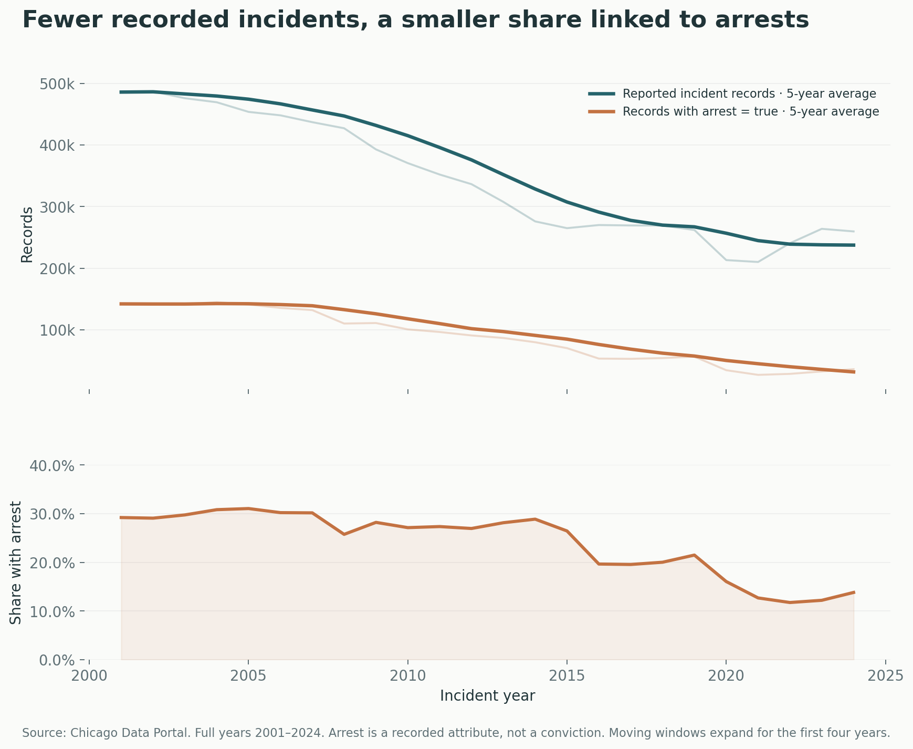
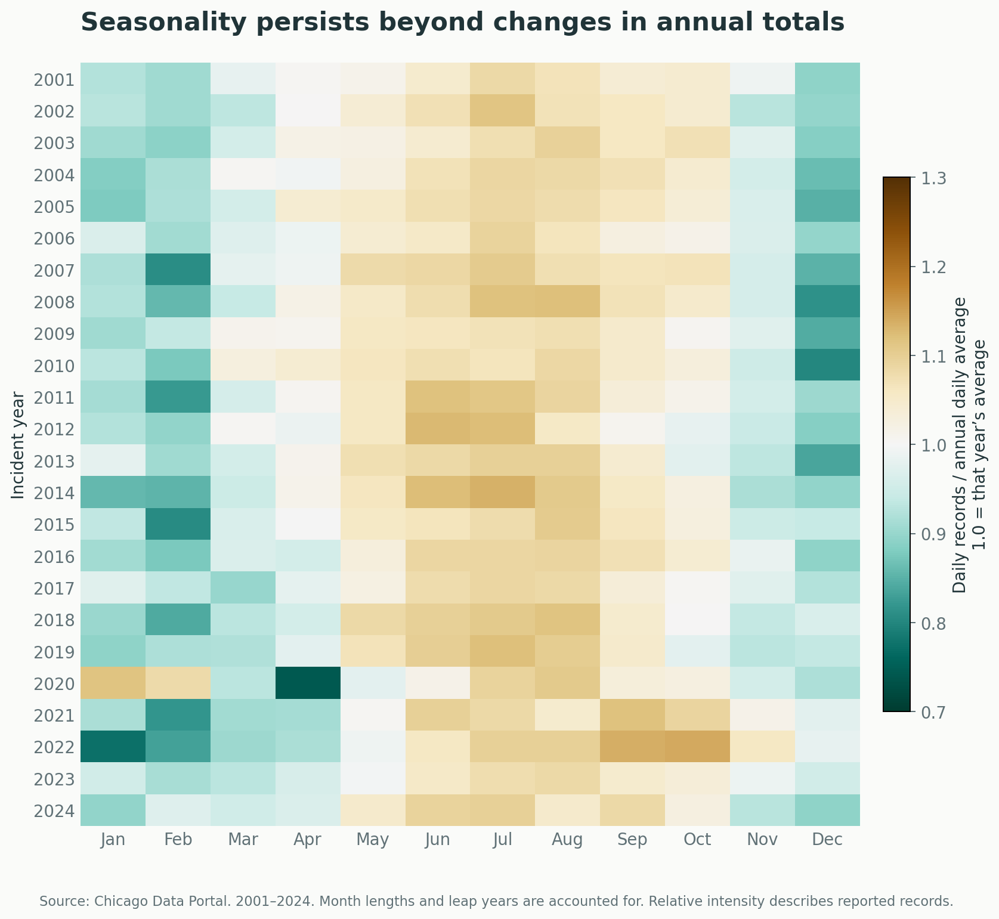
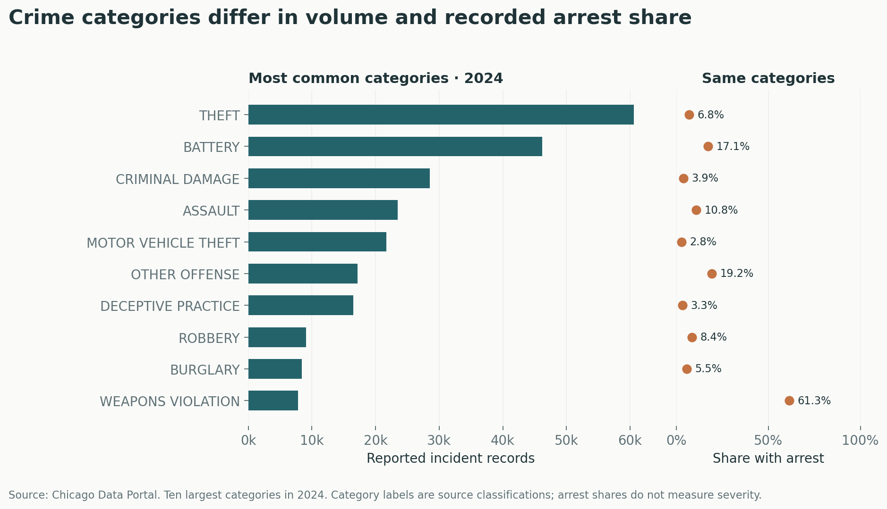
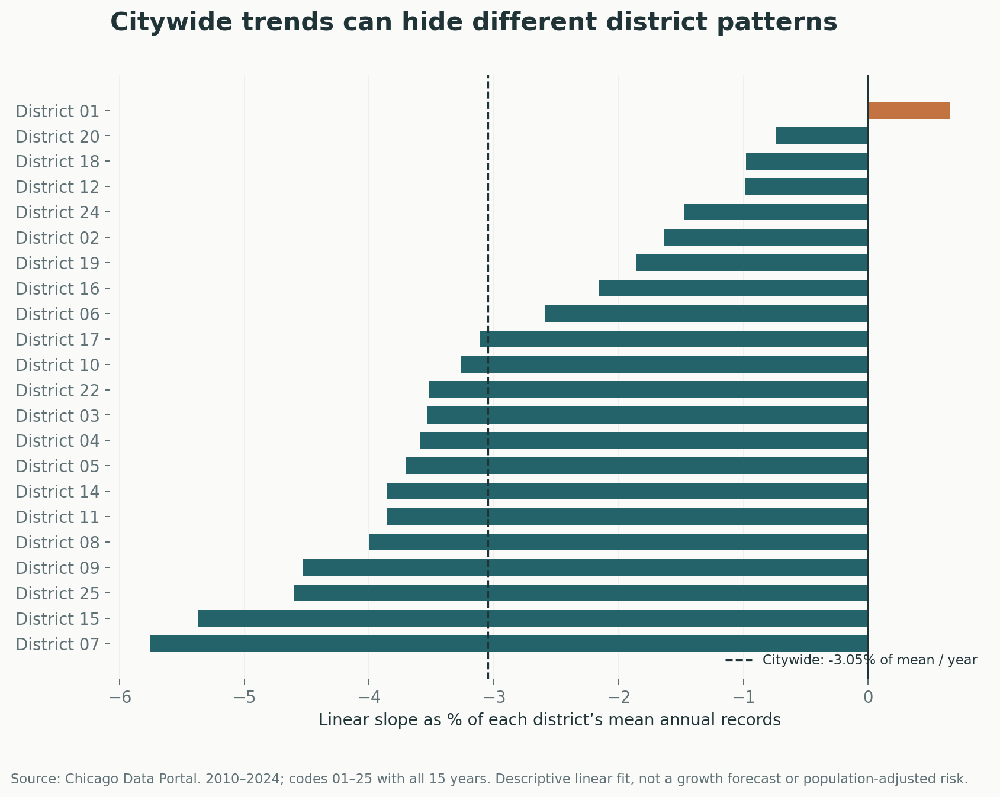

# Chicago Crime: What Citywide Totals Can Hide

**Hesub Chaka · SQL · Python · Data validation · Visualization**

How have Chicago’s reported crime patterns and recorded arrest shares changed, and what does a citywide total leave out?

This project follows **8,459,600 public crime records** from source queries to validated summary tables, SQL analysis, and four visualizations. It examines annual patterns, seasonality, crime categories, and district trends.



## Findings

- **Reported records fell 46.6% from 2001 to 2024**, while the share with an arrest flag declined from **29.2% to 13.8%** in this snapshot.
- **Summer daily records average 1.09× their year’s daily average**, compared with 0.90× in winter, after adjusting for month length.
- **Theft has the largest recorded volume in 2024.** Arrest shares vary substantially across categories.
- **District patterns add nuance:** 21 of 22 complete district series have negative fitted slopes for 2010–2024. District 01’s positive slope has a low R² (~0.03), so a straight line explains little of its annual variation.

These are descriptive findings about reported records. They do not establish causes, population-adjusted risk, or police effectiveness.

## Explore the project

| Notebook | Focus |
|---|---|
| [Public data pipeline](notebooks/01_Public_Data_Pipeline.ipynb) | Provenance, extraction queries, district-code normalization and reconciliation |
| [SQL analysis](notebooks/02_SQL_Analysis.ipynb) | Window functions, category comparisons, regression calculations, charts and interpretations |

Both notebooks include executed outputs. The CSVs needed to rerun the analysis are included; no university database access or credentials are required.

## Seasonal patterns



Each cell compares a month’s daily reported records with that year’s daily average. A value of 1.0 means average intensity for that year.

## Category volume and arrest share



A large recorded volume and a high arrest share measure different things. The two views use the same ten largest categories in 2024.

## District comparisons



The chart scales each fitted slope by its district’s mean annual records. It is a descriptive slope, not an annual growth forecast. Only numeric district codes 01–25 with all 15 years are shown. All source district codes, including missing and other values, remain in citywide totals.

## How it works

1. Query the [City of Chicago’s public source](https://data.cityofchicago.org/Public-Safety/Crimes-2001-to-Present/ijzp-q8t2/about_data) using Socrata’s SQL-like API.
2. Save annual, monthly, district/year and category/year aggregate tables with query parameters, timestamps and SHA-256 checksums.
3. Normalize district-code formatting and reconcile every rollup to the annual counts.
4. Load summaries into in-memory SQLite and use SQL windows, grouped aggregates, CTEs and centered regression calculations.
5. Verify SQL slopes with NumPy and render charts using matplotlib.

The API aggregates **8,459,600 source records** into compact tables; the repository does not claim to load that many raw rows locally.

## Run locally

```bash
python -m pip install -r requirements.txt
python scripts/analyze.py
jupyter notebook
```

Open the notebooks in numerical order. Analysis runs from the saved CSVs without network access. To deliberately refresh the source snapshot:

```bash
python scripts/fetch_data.py
python scripts/analyze.py
```

After a refresh, rerun the notebooks and update written findings before publishing. Refreshing can change historical counts. The live API does not provide an atomic multi-query snapshot; reconciliation checks detect count differences between requests.

## Data scope and original project

- **Incident dates:** January 1, 2001–November 23, 2025. Full-year comparisons end in 2024.
- **Unit:** source records, including victim-level homicide records. The scope contains **8,458,992 distinct case numbers**; repeated case numbers are not silently removed.
- **Retrieval:** see [manifest](data/manifest.json) for exact query-level UTC timestamps and checksums.
- **Project origin:** developed from an academic database-analysis exercise and rebuilt here using independently retrieved public aggregates. Every numerical finding in this repository is calculated from the included public snapshot.

## Validation and interpretation

The pipeline checks aggregate key uniqueness, month coverage, valid count ranges, agreement across all annual rollups, the independent API record total, and SQL regression agreement with NumPy.

Arrest flags are neither convictions nor clearance rates. Population, reporting, enforcement, classification and district-boundary changes can influence these descriptive comparisons. The City notes that source records are preliminary and may be revised. Comparisons over time should be interpreted cautiously.

**Tools:** Python, pandas, NumPy, SQLite, Socrata SQL-like queries, matplotlib and Jupyter. No individual-level records or credentials are included.

AI assisted query development, revision and presentation. The public edition’s numerical findings are backed by saved source summaries, executed notebooks and validation checks.
